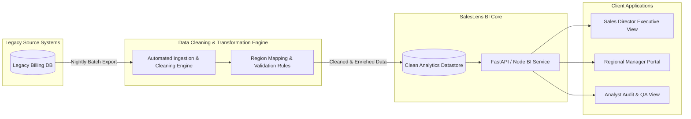

# IEEE 830-1998 Software Requirements Specification (SRS)
## Project Name: SalesLens - Unified Sales Reporting & Analytics Dashboard
**Document Version:** 1.0  
**Course:** B.Tech CSE Semester III — Software Engineering & Project Management  
**Target Delivery:** 8 Weeks (Annual Sales Conference Milestone)  

---

## 1. Introduction

### 1.1 Purpose
This Software Requirements Specification (SRS) document defines the complete functional and non-functional requirements for the **SalesLens** Sales Reporting Dashboard. It establishes a formal contract between the business stakeholders (Sales Director, Regional Sales Managers, Financial & Business Analysts) and the Engineering Team (BI Developer, Data Analyst, IT Systems Administrator).

### 1.2 Scope
SalesLens is an enterprise automated reporting and business intelligence solution designed for a consumer goods distribution enterprise. It replaces the error-prone, manually compiled 40-page weekly PDF reports with an automated, centralized, role-based interactive dashboard. The system ingests daily sales transactions from the legacy billing engine, resolves data anomalies (specifically the 14% missing region code transactions), computes standardized KPIs, and delivers high-performance analytics across 9 critical dashboard views.

### 1.3 Definitions, Acronyms, and Abbreviations
- **SRS:** Software Requirements Specification (IEEE 830 Standard).
- **BI:** Business Intelligence.
- **NFR:** Non-Functional Requirement.
- **FR:** Functional Requirement.
- **RBAC:** Role-Based Access Control.
- **DRE:** Defect Removal Efficiency.
- **BVA:** Boundary Value Analysis.
- **ECP:** Equivalence Class Partitioning.
- **ETL:** Extract, Transform, Load.
- **KPI:** Key Performance Indicator.
- **MoSCoW:** Must Have, Should Have, Could Have, Won't Have.
- **RTM:** Requirements Traceability Matrix.
- **FTE:** Full-Time Equivalent.

### 1.4 Business Context & Problem Justification
- **As-Is State:** Two data analysts spend 16+ hours over weekends manually synthesizing disparate spreadsheets into 40-page PDF documents. Inconsistent personal calculation rules lead to conflicting figures across regions, eroding leadership confidence. Furthermore, 14% of billing transactions lack region identification.
- **To-Be State:** Automated overnight ETL pipeline standardizing cleaning rules, instant role-specific analytics, sub-2 second query execution, 100% auditable figures, and delivery within an 8-week timeline for the annual sales conference.

---

## 2. Overall Description

### 2.1 Product Perspective
SalesLens operates as a self-contained web-based analytical presentation layer integrated upstream with the legacy ERP/Billing Relational Database via an automated staging pipeline.



### 2.2 User Classes and Characteristics
1. **Sales Director (Executive):** Requires high-level organizational visibility, nation-wide target vs. actual variance, multi-region comparative matrix, and top product category distribution. High priority on data consistency and aggregated summary speed.
2. **Regional Sales Managers (Operational):** Requires granular drill-downs for assigned territory (North, South, East, West, Central), daily pacing vs quota, distributor-level breakdown, and product performance.
3. **Data Analysts (Supervisory/Validation):** Requires data lineage inspection, unassigned transaction audit queues, anomaly logs (14% missing region resolutions), and ad-hoc filtered export capabilities.
4. **IT / System Administrator (Maintenance):** Oversees ETL batch job schedules, database integrity, user access provisioning, security rules, and audit trails.

### 2.3 Operating Environment
- **Client Tier:** Modern standard web browsers (Google Chrome $\ge 110$, Mozilla Firefox $\ge 115$, Apple Safari $\ge 16$, Microsoft Edge $\ge 110$) on Desktop and Tablet devices.
- **Application & ETL Tier:** Containerized Node.js/Python microservices behind Nginx reverse proxy.
- **Database Tier:** PostgreSQL / Analytical Columnar Store with automated daily indexed snapshots.

### 2.4 Design and Implementation Constraints
1. **Strict 8-Week Timeline:** Delivery must coincide with the Annual Sales Conference. Scope is mathematically constrained to 9 high-value views.
2. **Resource Constraint:** 1 Full-Time BI Developer (1.0 FTE) and 1 Part-Time Analyst (0.5 FTE).
3. **Legacy Data Quality Constraint:** 14% missing region codes must be handled algorithmically (via zip/postal mapping, customer master lookup, sales-rep territory mapping) without halting daily load.
4. **No Direct Production DB Overload:** Read-only replica or scheduled off-peak ETL extract to avoid impacting transactional billing performance.

---

## 3. Functional Requirements (FR-01 to FR-10)

| Req ID | Requirement Title | Detailed Description | MoSCoW | User Persona |
| :--- | :--- | :--- | :--- | :--- |
| **FR-01** | **Daily Sales & Revenue Aggregation** | The system shall automatically ingest daily settled billing transactions and compute total revenue, units sold, and invoice counts aggregated by date, brand, category, and SKU. | **Must Have** | Sales Director, Regional Mgr |
| **FR-02** | **Target vs. Actual Quota Tracking** | The system shall compute and visualize real-time variance (absolute currency and percentage attainment) between actual gross sales and monthly/quarterly budgeted targets. | **Must Have** | Sales Director, Regional Mgr |
| **FR-03** | **Top & Bottom Product SKU Performance** | The system shall rank all products by revenue contribution, margin, and volume velocity, allowing filtering by top 10, top 20, and bottom 10 underperforming SKUs. | **Must Have** | Sales Director, Analyst |
| **FR-04** | **Regional Comparison & Territory Matrix** | The system shall provide side-by-side comparative views of all 5 geographic zones (North, South, East, West, Central) evaluating revenue growth, market share, and target completion rate. | **Must Have** | Sales Director |
| **FR-05** | **Automated 14% Missing Region Code Cleaning** | The system ETL engine shall execute a 4-tier waterfall resolution algorithm (Postal Code $\rightarrow$ Customer Master File $\rightarrow$ Sales Rep Assignment $\rightarrow$ Flagged 'Unassigned-Audit') to classify missing region transactions. | **Must Have** | Analyst, IT Admin |
| **FR-06** | **Role-Based Access Control (RBAC)** | The system shall restrict data visibility such that Regional Managers only view data for their assigned territory, while the Sales Director and Analysts have national visibility. | **Must Have** | All Personas |
| **FR-07** | **Interactive Temporal & Categorical Filters** | The system shall enable dynamic multi-parameter filtering by Custom Date Range, Fiscal Quarter, Product Category, Distributor Channel, and Region with instant UI recalculation. | **Should Have** | Regional Mgr, Director |
| **FR-08** | **Data Cleaning Audit & Anomaly Log** | The system shall maintain an auditable log of all data cleaning transformations, displaying exact before/after mapping records and confidence scores for resolved records. | **Should Have** | Analyst, IT Admin |
| **FR-09** | **Exportable Executive PDF & CSV Briefings** | The system shall generate a single-page formatted executive PDF summary and raw filtered CSV data export on-demand with timestamped digital watermarks. | **Could Have** | Sales Director, Analyst |
| **FR-10** | **Automated Daily Email & Webhook Digest** | The system shall dispatch an automated morning email summary of yesterday's key metrics and target pacing to subscribed managers at 07:00 AM local time. | **Won't Have (Phase 2)** | Regional Mgr, Director |

---

## 4. Non-Functional Requirements (Measurable NFR-01 to NFR-07)

*Every NFR contains an unambiguous, measurable metric and verification protocol.*

```
+---------------------------------------------------------------------------------------+
|                                MEASURABLE NFR MATRIX                                  |
+--------+----------------------+---------------------------------+---------------------+
| ID     | Quality Attribute    | Quantitative Target Metric      | Verification Method |
+--------+----------------------+---------------------------------+---------------------+
| NFR-01 | Data Accuracy        | >= 99.90% reconcilable revenue  | Financial automated |
|        |                      | Delta <= $10.00 per $1M volume  | daily audit script  |
+--------+----------------------+---------------------------------+---------------------+
| NFR-02 | Ingestion & Refresh  | Overnight ETL <= 15 minutes     | CloudWatch / cron   |
|        |                      | Completed daily before 06:00 AM | timestamp telemetry |
+--------+----------------------+---------------------------------+---------------------+
| NFR-03 | UI Query Latency     | 95th percentile <= 1.50 seconds | Lighthouse / APM    |
|        |                      | Max load time <= 3.00 seconds   | synthetic benchmark |
+--------+----------------------+---------------------------------+---------------------+
| NFR-04 | Security & RBAC      | Zero unauthorized row leakage   | Automated security  |
|        |                      | 100% token-based auth (JWT)     | penetration test    |
+--------+----------------------+---------------------------------+---------------------+
| NFR-05 | System Availability  | >= 99.50% uptime during core    | Pingdom uptime      |
|        |                      | hours (06:00 to 22:00 Mon-Sat)  | monitor SLA reports |
+--------+----------------------+---------------------------------+---------------------+
| NFR-06 | Concurrent Capacity  | >= 50 concurrent active users   | JMeter load testing |
|        |                      | without > 10% latency surge     | with ramp-up curves |
+--------+----------------------+---------------------------------+---------------------+
| NFR-07 | Disaster Recovery    | RPO <= 24 hours (daily snapshot)| Automated backup    |
|        | & Fault Tolerance    | RTO <= 60 minutes for cold boot | restoration drills  |
+--------+----------------------+---------------------------------+---------------------+
```

### Detailed NFR Specifications:
1. **NFR-01: Data Accuracy & Financial Integrity**
   - *Target:* Reconciled daily revenue on the dashboard must match settled transactional billing totals with $\ge 99.90\%$ precision. Maximum tolerable unexplained variance $< 0.01\%$.
2. **NFR-02: Pipeline Refresh Window**
   - *Target:* Daily batch ETL execution duration shall not exceed 15 minutes (900 seconds) for up to 500,000 daily transaction lines, finishing reliably before 06:00 AM Eastern Standard Time.
3. **NFR-03: Performance & Response Time**
   - *Target:* Dashboard view render time under standard broadband ($\ge 10\text{ Mbps}$) shall be $\le 1.5$ seconds for 95% of queries ($P_{95} \le 1500\text{ms}$) and never exceed $3.0$ seconds on initial cold load.
4. **NFR-04: Access Control & Security**
   - *Target:* $100\%$ of analytical queries must enforce role-based row-level filtering. Zero cross-region data exposure across $10,000$ automated penetration test assertions.
5. **NFR-05: System Availability & Uptime**
   - *Target:* Dashboard availability shall achieve $\ge 99.5\%$ uptime during business operating hours ($06:00 - 22:00\text{ local time}$, Monday through Saturday), allowing at most $4.2$ hours of scheduled off-peak maintenance per month.
6. **NFR-06: Concurrency & Scalability**
   - *Target:* The system shall support at least 50 simultaneous active regional managers executing filter switches with CPU utilization remaining below $70\%$ and memory consumption below $80\%$.
7. **NFR-07: Data Disaster Recovery**
   - *Target:* Recovery Point Objective (RPO) $\le 24$ hours (guaranteed by daily point-in-time snapshots) and Recovery Time Objective (RTO) $\le 60$ minutes from total instance failure.

---

## 5. Scope Management (9 In-Scope vs. 17 Excluded Reports)

### 5.1 Scope Boundary Analysis
The original legacy reporting catalog contained **26 disparate reports**. Comprehensive stakeholder usage auditing confirmed that **only 9 core views** are actively utilized for decision-making. 

```
Total Legacy Catalog: 26 Reports
├── In-Scope for SalesLens (9 High-Value Core Views) -> 27 Person-Days Effort
└── Out-of-Scope Excluded (17 Low-Value/Obsolete Reports) -> 51 Person-Days Saved!
```

### 5.2 In-Scope vs. Out-of-Scope Itemized Matrix

| Item # | View / Report Name | Scope Status | Business Justification & Stakeholder Value | Impact on Time, Cost & Quality |
| :--- | :--- | :--- | :--- | :--- |
| **01** | Executive Daily Sales & Revenue Pulse | **IN-SCOPE** | Core daily pacing metric required by Sales Director. | High value, 3 days effort, high quality gain. |
| **02** | Target vs. Actual Quota Attainment | **IN-SCOPE** | Essential for quarterly performance compensation. | Core KPI, 3 days effort, eliminates manual dispute. |
| **03** | Top 20 Revenue Generating SKUs | **IN-SCOPE** | Focuses supply chain and distributor priority. | 3 days effort, delivers 80/20 inventory clarity. |
| **04** | Bottom 10 Underperforming Products | **IN-SCOPE** | Identifies SKU rationalization and promo needs. | 3 days effort, optimizes shelf space. |
| **05** | Regional Performance Comparison Matrix | **IN-SCOPE** | Benchmarks 5 geographic territories side-by-side. | 3 days effort, critical for director's review. |
| **06** | Regional Manager Territory Deep-Dive | **IN-SCOPE** | Granular regional view for operational manager decisions. | 3 days effort, enforces secure RBAC boundaries. |
| **07** | Category & Brand Contribution Split | **IN-SCOPE** | High-level portfolio mix breakdown. | 3 days effort, guides category management. |
| **08** | Channel / Distributor Performance View | **IN-SCOPE** | Tracks distributor sales tiers and concentration. | 3 days effort, prevents key-account credit risks. |
| **09** | Data Quality & Unassigned Audit Console | **IN-SCOPE** | Transparent tracking of the 14% cleaned records. | 3 days effort, builds analyst trust & governance. |
| **10-14**| Obsolete Legacy Branch Paper Slips (5 rpts) | **OUT-OF-SCOPE** | Replaced entirely by automated billing transactions. | Saved 15 person-days; zero business utility. |
| **15-18**| Individual Delivery Vehicle Fuel Logs (4 rpts) | **OUT-OF-SCOPE** | Logistics/Fleet operational scope, not sales BI. | Saved 12 person-days; eliminates scope creep. |
| **19-22**| Redundant Analyst Scratch Spreadsheets (4 rpts)| **OUT-OF-SCOPE** | Duplicate ad-hoc calculations now in Views 1-5. | Saved 12 person-days; eliminates contradictory data. |
| **23-26**| Annual Static Archive Printouts (4 rpts) | **OUT-OF-SCOPE** | Historical batch dumps replaced by dynamic date filters.| Saved 12 person-days; reduces database bloat. |

### 5.3 Tri-Factor Impact Summary
- **Time Impact:** Trimming 17 unnecessary reports saves **51 person-days** of engineering effort, reducing project duration from 60.7 working days (12.2 weeks) down to **26.7 working days (5.4 weeks)**, making the strict 8-week conference deadline achievable with a comfortable buffer.
- **Cost Impact:** Avoids $65\%$ unnecessary development expenditure and reduces long-term maintenance overhead.
- **Quality Impact:** Concentrates engineering bandwidth on robust ETL testing, region-code cleaning algorithms, and ultra-responsive UX.

---

## 6. Requirements Traceability Matrix (RTM)

| Functional Req ID | Requirement Description | Design Element (UML) | Test Case ID | Test Category | Target NFR Link |
| :--- | :--- | :--- | :--- | :--- | :--- |
| **FR-01** | Daily Sales Aggregation | `SalesAggregatorService` | `TC-SALES-01` | Functional / BVA | NFR-01, NFR-02 |
| **FR-02** | Target vs Actual Variance | `QuotaComputationEngine` | `TC-QUOTA-02` | Unit / BVA | NFR-01 |
| **FR-03** | Top/Bottom SKU Ranker | `ProductRankingController` | `TC-RANK-03` | Functional | NFR-03 |
| **FR-04** | Regional Comparison Matrix | `RegionAnalyticsComponent`| `TC-REGCOMP-04`| Integration | NFR-01, NFR-03 |
| **FR-05** | 14% Missing Region Cleaning| `RegionResolutionEngine` | `TC-CLEAN-05` | Decision Table | NFR-01 |
| **FR-06** | Role-Based Access Control | `SecurityAuthMiddleware` | `TC-SEC-06` | Security / Matrix | NFR-04 |
| **FR-07** | Interactive Date/Filter Engine| `FilterStateStore` | `TC-FILT-07` | UI / Boundary | NFR-03 |
| **FR-08** | Data Quality Audit Log | `AuditLoggerModule` | `TC-AUDIT-08` | System / DRE | NFR-01 |
| **FR-09** | Executive Export Engine | `ReportExportService` | `TC-EXP-09` | Output Validation | NFR-03 |
| **FR-10** | Morning Digest Dispatcher | `NotificationCronService` | `TC-NOTIF-10` | Regression / Phase2| NFR-02 |

---

*End of IEEE 830 Specification.*
