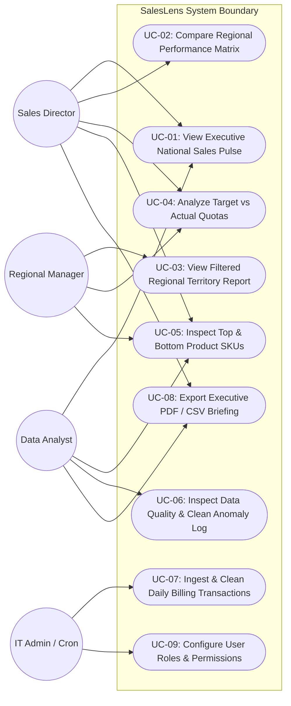
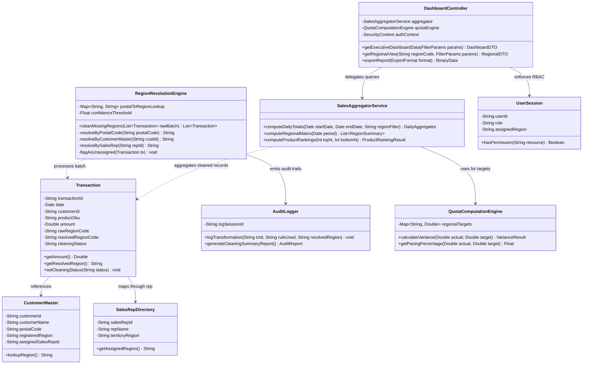
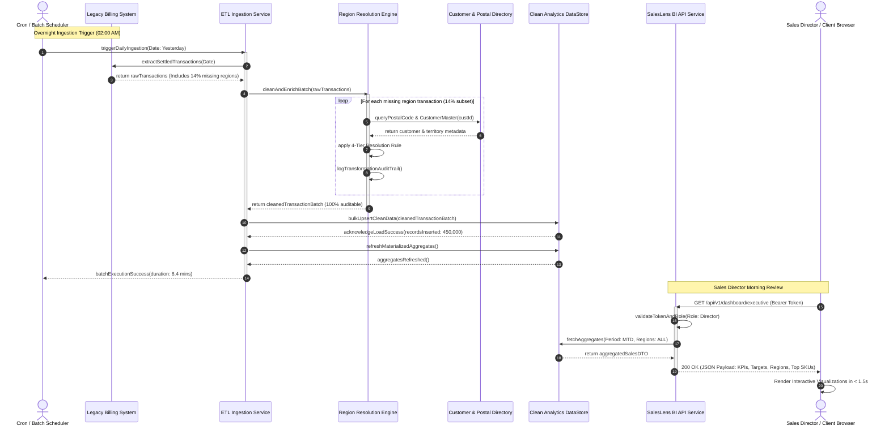
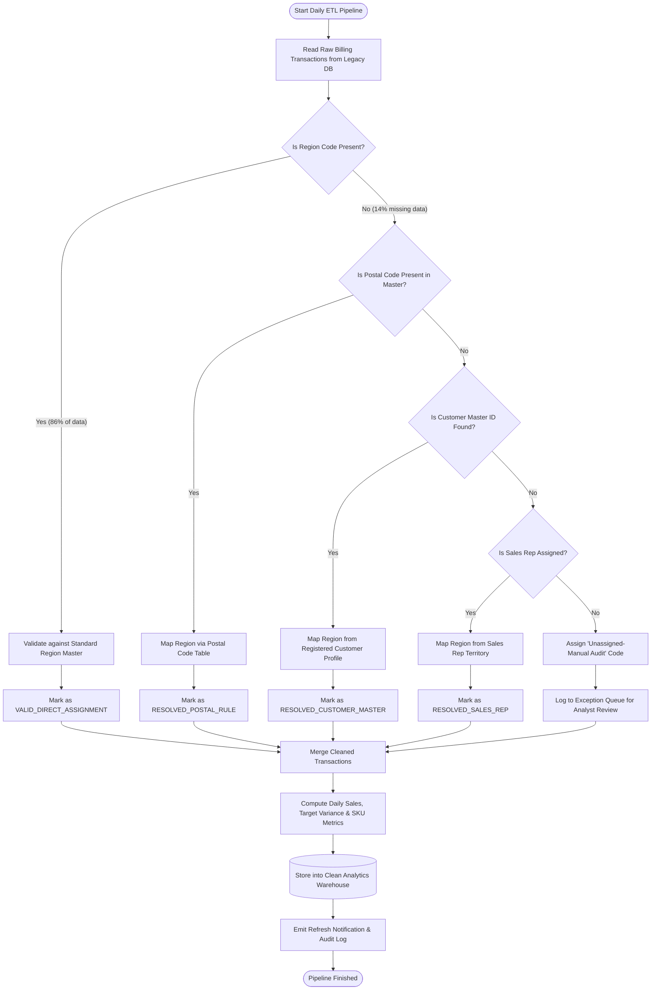
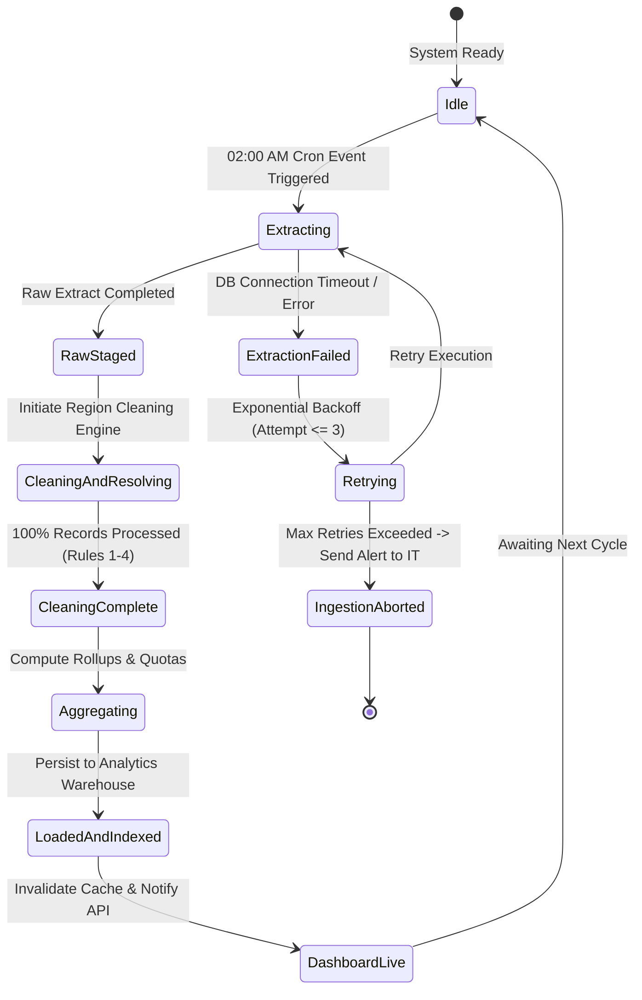
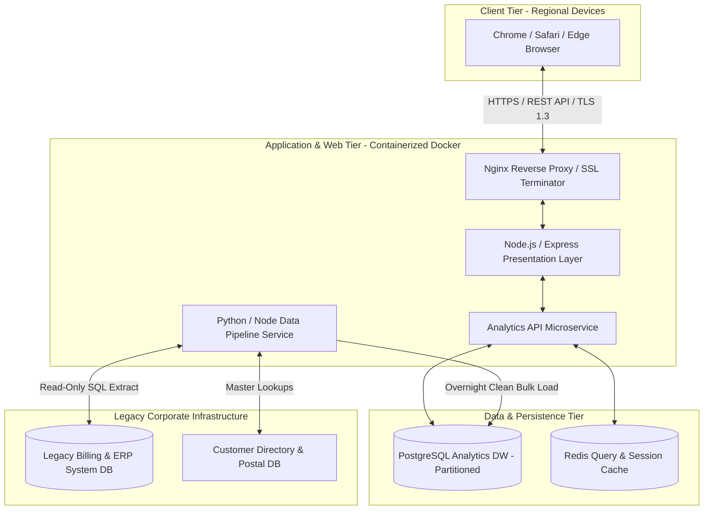

# Software Design & UML Architecture Package
## Project Name: SalesLens - Enterprise BI Dashboard
**Document Version:** 1.0  
**Course:** B.Tech CSE Semester III — Software Engineering & Project Management  
**Prescribed Textbooks:** *Software Engineering* by Ian Sommerville | *Software Project Management* by Bob Hughes & Mike Cotterell

---

## 1. Executive Design Summary & Architectural Overview

SalesLens adopts a **Layered Service-Oriented Model-View-Controller (MVC) Architecture** with an asynchronous **Extract-Transform-Load (ETL) Pipeline Pipeline-and-Filter Subsystem**. 

The design strictly enforces:
- **Low Coupling:** The Data Cleaning Engine operates independently of the Presentation Layer. Dashboard views interact exclusively with an aggregated Data Access Layer (DAL) through standardized Data Transfer Objects (DTOs). If billing schema or region mapping logic changes, dashboard views require zero code modifications.
- **High Cohesion:** Each module is single-purposed. The `RegionResolutionEngine` only handles address and territory reconciliation; the `QuotaComputationEngine` solely calculates variances; and the `DashboardViewRenderer` only manages visual presentation and UI state.

---

## 2. UML Diagrams

### 2.1 Use Case Diagram

#### Use Case Specification Summary
- **UC-01 (Executive Sales Pulse):** Sales Director reviews national totals, daily pacing, and macro trends.
- **UC-03 (Regional Territory Report):** Regional Manager analyzes territory-specific revenue bounded by RBAC.
- **UC-06 (Data Quality Audit):** Analyst audits the 14% resolved missing region transactions to ensure mapping rule integrity.
- **UC-07 (Ingest & Clean Data):** Automated overnight ETL batch extracts raw billing lines, executes cleaning rules, and updates the analytical data warehouse.

---

### 2.2 Class Diagram (Domain & Subsystem Design)

---

### 2.3 Sequence Diagram: "Load Daily Sales and Refresh the Dashboard"

*Demonstrates the complete end-to-end automated sequence from overnight legacy ingestion to executive UI refresh.*

---

### 2.4 Activity Diagram: Data Cleaning & Transformation Pipeline

---

### 2.5 State Machine Diagram: Sales Data Load Lifecycle

---

### 2.6 Deployment Diagram

---

## 3. Cohesion and Coupling Architectural Justification

### 3.1 Loose Coupling Justification
1. **Separation of Cleaning Rules from Visualization:**  
   The `RegionResolutionEngine` has zero dependency on the frontend UI or charting library. It takes raw database records, applies deterministic mapping rules, and stores clean relational records. If the sales director later requests a new chart type (e.g., Radar Chart instead of Bar Chart), the data pipeline remains untouched. Conversely, if a new postal code is annexed, only the lookup table is updated without altering dashboard controllers.
2. **Standardized DTO Contract (Interface Segregation):**  
   Communication between the backend and frontend occurs over strict JSON REST interfaces (`DashboardDTO`). UI views never execute raw SQL against the legacy database, preventing schema coupling.
3. **Plug-and-Play Authentication Middleware:**  
   RBAC filters are implemented as decoupled HTTP interceptor middleware. The analytical query services receive an already-sanitized `UserContext` and simply append a `WHERE region = user.assignedRegion` clause if the user is a Regional Manager.

### 3.2 High Cohesion Justification
1. **Functional Cohesion in ETL:**  
   The `RegionResolutionEngine` performs only one logical task: resolving ambiguous geographic indicators to certified regional codes. It does not calculate quotas, render HTML, or authenticate users.
2. **Layered Architectural Cohesion:**  
   - **Data Access Layer:** Exclusively manages database connection pooling, caching, and SQL query execution.
   - **Service Layer:** Exclusively executes business domain calculations (e.g., target variance, compound growth).
   - **Presentation Layer:** Exclusively handles HTTP request parsing, response formatting, and responsive browser rendering.
3. **Maintainability Impact:**  
   Because every class has a single, well-defined responsibility (Single Responsibility Principle), unit testing is straightforward, defect isolation is instantaneous, and regression risks during future upgrades are minimized.

---

*End of Software Design & UML Specification.*
