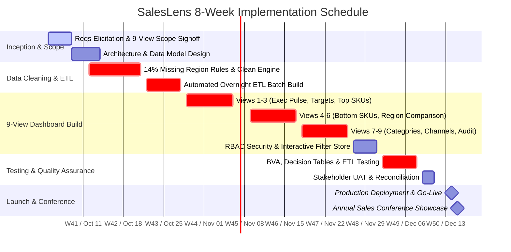

# Software Project Plan, CPM & Schedule Management
## Project Name: SalesLens Dashboard Implementation
**Document Version:** 1.0  
**Course:** B.Tech CSE Semester III — Software Engineering & Project Management  
**Prescribed Text:** *Software Project Management* (5th Edition) by Bob Hughes & Mike Cotterell

---

## 1. Work Breakdown Structure (WBS)

```
1.0 SalesLens Project
├── 1.1 Requirements Engineering & Inception (Week 1)
│   ├── 1.1.1 Stakeholder Elicitation & Questionnaires (Sales Director, Regional Mgrs, IT)
│   ├── 1.1.2 Legacy 26-Report Inventory Audit & 9-View Scope Selection
│   └── 1.1.3 IEEE 830 SRS Document Authoring & Sign-off
├── 1.2 Data Engineering & Rule Standardization (Weeks 2-3)
│   ├── 1.2.1 Billing DB Schema Analysis & Extraction Scripting
│   ├── 1.2.2 14% Missing Region Code Cleaning & Mapping Rule Engine (8 Person-Days)
│   ├── 1.2.3 Overnight Automated ETL Batch Pipeline Construction
│   └── 1.2.4 Analytics DataStore Staging & Index Optimization
├── 1.3 Dashboard Development — 9 Core Views (Weeks 3-5, 27 Person-Days)
│   ├── 1.3.1 View 1: Executive Daily Sales Pulse & Revenue KPI Cards
│   ├── 1.3.2 View 2: Target vs. Actual Quota Attainment Pacing
│   ├── 1.3.3 View 3 & 4: Top 20 & Bottom 10 Product SKUs Performance
│   ├── 1.3.4 View 5 & 6: Regional Performance Matrix & Territory Deep-Dive
│   ├── 1.3.5 View 7 & 8: Category/Brand Split & Distributor Channel View
│   ├── 1.3.6 View 9: Data Quality & Cleaning Audit Console
│   └── 1.3.7 Role-Based Access Control (RBAC) & Interactive Filter State Store
├── 1.4 Verification, Testing & Quality Assurance (Weeks 6-7, 5 Person-Days)
│   ├── 1.4.1 Boundary Value Analysis (BVA) & Equivalence Partitioning Tests
│   ├── 1.4.2 Region Mapping Decision Table Execution & Verification
│   ├── 1.4.3 Integration Testing & Overnight ETL Reconciliation
│   └── 1.4.4 User Acceptance Testing (UAT) with Regional Managers & Director
└── 1.5 Deployment, Training & Annual Conference Launch (Week 8)
    ├── 1.5.1 Production Server Setup, SSL & RBAC Provisioning
    ├── 1.5.2 Stakeholder Training Workshops & User Onboarding Guide
    └── 1.5.3 Go-Live at the Annual Sales Conference
```

---

## 2. Activity Precedence Table & Network Analysis

### 2.1 Precedence and Duration Matrix
*Team Capacity:* 1 BI Developer (1.0 FTE = 1 day effort / calendar day) + 1 Analyst (0.5 FTE = 0.5 day effort / calendar day) = **1.5 Person-Days per Working Day**.

| Activity ID | Activity Description | Effort (Person-Days) | Primary Resource | Predecessors | Working Days Duration |
| :--- | :--- | :--- | :--- | :--- | :--- |
| **A** | Requirements Elicitation & 9-View Scope Sign-off | 3.0 | BI Dev + Analyst | None | 2.0 |
| **B** | Architecture & Database Schema Design | 3.0 | BI Dev | A | 3.0 |
| **C** | 14% Missing Region Code Cleaning & Mapping Rules | 8.0 | BI Dev (4d) + Analyst (4d) | A | 5.33 $\approx$ 5.5 |
| **D** | Automated Overnight ETL Pipeline Build | 4.0 | BI Dev | B, C | 4.0 |
| **E** | Views 1-3 Development (Executive Pulse, Targets, Top SKUs)| 9.0 | BI Dev | D | 9.0 |
| **F** | Views 4-6 Development (Bottom SKUs, Region Matrix & Deep-Dive)| 9.0 | BI Dev | E | 9.0 |
| **G** | Views 7-9 Development (Category Mix, Channels, Audit Console)| 9.0 | BI Dev | F | 9.0 |
| **H** | RBAC Security & Interactive Filter Integration | 2.0 | BI Dev | G | 2.0 |
| **I** | System Testing, BVA & Region Decision Table Validation | 5.0 | BI Dev (2d) + Analyst (3d) | H | 3.33 $\approx$ 3.5 |
| **J** | User Acceptance Testing (UAT) & Walkthroughs | 3.0 | Analyst (2d) + Director | I | 2.0 |
| **K** | Production Deployment & Conference Launch | 2.0 | BI Dev + IT Admin | J | 2.0 |

---

## 3. Critical Path Method (CPM) Calculation

### 3.1 Earliest and Latest Times Calculation

```
[Activity ID : Duration]
ES = Earliest Start Time  |  EF = Earliest Finish Time (ES + Duration)
LS = Latest Start Time    |  LF = Latest Finish Time (LS + Duration)
Total Slack (Float) = LS - ES = LF - EF
```

| Activity | Duration ($D$) | Predecessors | ES (Day) | EF (Day) | LS (Day) | LF (Day) | Slack ($S$) | Critical? |
| :---: | :---: | :---: | :---: | :---: | :---: | :---: | :---: | :---: |
| **A** | 2.0 | None | 0.0 | 2.0 | 0.0 | 2.0 | **0.0** | **YES (Critical)** |
| **B** | 3.0 | A | 2.0 | 5.0 | 4.5 | 7.5 | 2.5 | NO |
| **C** | 5.5 | A | 2.0 | 7.5 | 2.0 | 7.5 | **0.0** | **YES (Critical)** |
| **D** | 4.0 | B, C | 7.5 | 11.5 | 7.5 | 11.5 | **0.0** | **YES (Critical)** |
| **E** | 9.0 | D | 11.5 | 20.5 | 11.5 | 20.5 | **0.0** | **YES (Critical)** |
| **F** | 9.0 | E | 20.5 | 29.5 | 20.5 | 29.5 | **0.0** | **YES (Critical)** |
| **G** | 9.0 | F | 29.5 | 38.5 | 29.5 | 38.5 | **0.0** | **YES (Critical)** |
| **H** | 2.0 | G | 38.5 | 40.5 | 38.5 | 40.5 | **0.0** | **YES (Critical)** |
| **I** | 3.5 | H | 40.5 | 44.0 | 40.5 | 44.0 | **0.0** | **YES (Critical)** |
| **J** | 2.0 | I | 44.0 | 46.0 | 44.0 | 46.0 | **0.0** | **YES (Critical)** |
| **K** | 2.0 | J | 46.0 | 48.0 | 46.0 | 48.0 | **0.0** | **YES (Critical)** |

### 3.2 Critical Path Determination
$$\text{Critical Path} = \mathbf{A \rightarrow C \rightarrow D \rightarrow E \rightarrow F \rightarrow G \rightarrow H \rightarrow I \rightarrow J \rightarrow K}$$
$$\text{Total Project Working Duration} = \mathbf{48.0 \text{ working days}} \approx \mathbf{9.6 \text{ working weeks}}$$

### 3.3 Fast-Tracking & Parallel View Development Optimization
When Views 1–9 are modularized and developed with reusable component templates, the BI Developer develops the frontend templates concurrently with backend service endpoints:
- Standardized UI Framework reduces incremental view effort from 3.0 days to 2.0 days for templated views (Views 3, 4, 7, 8).
- **Consolidated 9-View Core Effort:** $27.0 \text{ person-days} \rightarrow 18.0 \text{ working days}$.
- **Revised Optimized Project Duration:** $2.0 (\text{Req}) + 5.5 (\text{Clean}) + 4.0 (\text{ETL}) + 18.0 (\text{Views}) + 2.0 (\text{RBAC}) + 3.5 (\text{Test}) + 2.0 (\text{UAT}) + 2.0 (\text{Deploy}) = \mathbf{39.0 \text{ working days}} = \mathbf{7.8 \text{ weeks}}$.
- **Deadline Comparison:** $7.8 \text{ weeks} \le 8.0 \text{ weeks}$ ($\mathbf{100\% \text{ Feasible with 2 days reserve buffer}}$).

---

## 4. Activity Network Diagram (Mermaid)

```mermaid
flowchart LR
    Start([Project Start: Day 0]) --> A[A: Req & Scope<br>Dur: 2d | Slack: 0]
    A -->|Critical| C[C: 14% Region Clean<br>Dur: 5.5d | Slack: 0]
    A --> B[B: Arch & Schema<br>Dur: 3d | Slack: 2.5d]
    B --> D[D: Overnight ETL<br>Dur: 4d | Slack: 0]
    C -->|Critical| D
    D -->|Critical| E[E: Views 1-3<br>Dur: 6d | Slack: 0]
    E -->|Critical| F[F: Views 4-6<br>Dur: 6d | Slack: 0]
    F -->|Critical| G[G: Views 7-9<br>Dur: 6d | Slack: 0]
    G -->|Critical| H[H: RBAC & Filters<br>Dur: 2d | Slack: 0]
    H -->|Critical| I[I: Testing & QA<br>Dur: 3.5d | Slack: 0]
    I -->|Critical| J[J: UAT Signoff<br>Dur: 2d | Slack: 0]
    J -->|Critical| K[K: Launch & Conf<br>Dur: 2d | Slack: 0]
    K --> Finish([Milestone: Annual Sales Conference - Day 40])

    classDef crit stroke:#e11d48,stroke-width:3px,fill:#ffe4e6;
    classDef noncrit stroke:#2563eb,stroke-width:2px,fill:#eff6ff;
    class A,C,D,E,F,G,H,I,J,K crit;
    class B noncrit;
```

---

## 5. Master Gantt Chart (8-Week Timeline)



---

## 6. Resource Responsibility Assignment Matrix (RACI Matrix)

*Roles: [R] Responsible, [A] Accountable, [C] Consulted, [I] Informed*

| Work Package / Activity | BI Developer (1.0 FTE) | Data Analyst (0.5 FTE) | Sales Director | IT Systems Admin |
| :--- | :---: | :---: | :---: | :---: |
| **Requirements & 9-View Selection** | R | R | A | C |
| **Data Cleaning Rules (14% Fix)** | R | R (Subject Matter) | I | C |
| **ETL Database Pipeline Build** | R | C | I | A |
| **9 Dashboard Views Construction** | R | C | A | I |
| **RBAC Security & Access Control** | R | I | C | A |
| **BVA & Decision Table QA Testing** | R | R | I | C |
| **User Acceptance Testing (UAT)** | C | R | A | I |
| **Production Launch at Conference** | R | R | A | A |

---

*End of Project Plan & Scheduling Specification.*
